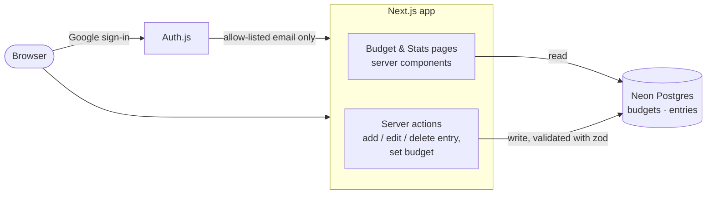

# INAB

A small, single-user budget tracker. Set one budget per month, log spending
as **Needs** or **Wants**, and see at a glance how much is left and whether
you're spending faster than the month is passing. A Stats tab looks back over
the past six months.

Built with Next.js (App Router), Neon Postgres, Drizzle ORM, and Auth.js
(Google sign-in), and designed to deploy on Vercel.

## How it fits together



Every request goes through a proxy that redirects to `/signin` until the
visitor has a session. Pages read straight from the database on the server,
and changes go through server actions that check the session and validate
their input before writing. All rows belong to the signed-in user.

## Features

- **Budget tab:** the large number at the top is what's left this month, which
  is the budget minus every entry. Click the budget to change it.
- **Pace strip:** shows how much of the budget you've spent, split by
  category, next to how far through the month you are.
- **Keypad entry:** a mobile-first form for adding an expense with a
  category, date, and optional note. Entries can be edited from the timeline.
- **Stats tab:** average monthly spend, average budget used, the peak month,
  spend compared with budget, and the category mix across the trailing six
  months.

## Design notes

- Money is stored as integer cents, and months are keyed `YYYY-MM`.
- A new month starts empty and inherits the most recent budget until you
  change it. Months roll over in the server's timezone (UTC on Vercel).
- Sign-in fails closed: only emails listed in `ALLOWED_EMAILS` can sign in,
  and if the list is empty, nobody can.
- Charts are plain SVG, with no chart library.

## Running your own

You'll need a Postgres database (the app uses Neon's serverless driver) and a
Google OAuth client whose redirect URI is `<your-origin>/api/auth/callback/google`.
Set these environment variables in `.env.local`:

| Variable             | Purpose                                         |
| -------------------- | ----------------------------------------------- |
| `DATABASE_URL`       | Postgres connection string                      |
| `AUTH_SECRET`        | Session secret (generate with `npx auth secret`) |
| `AUTH_GOOGLE_ID`     | Google OAuth client ID                          |
| `AUTH_GOOGLE_SECRET` | Google OAuth client secret                      |
| `ALLOWED_EMAILS`     | Comma-separated emails allowed to sign in       |

Then run:

```bash
npm install
npm run db:push   # create the tables
npm run dev
```

## Commands

| Command             | What it does                       |
| ------------------- | ---------------------------------- |
| `npm run dev`       | Dev server                         |
| `npm test`          | Unit tests (money, months, stats)  |
| `npm run build`     | Production build                   |
| `npm run lint`      | ESLint                             |
| `npm run db:push`   | Push the Drizzle schema to the DB  |
| `npm run db:studio` | Browse the DB in Drizzle Studio    |

## Clarifications

**Can anyone fork this and run their own copy?**
Yes. A fork contains only the code. To run it, you create your own database,
your own Google OAuth client, and your own `AUTH_SECRET` and
`ALLOWED_EMAILS`. That gives you a fully separate instance that shares no data
or credentials with any other deployment. A new Google OAuth app starts in
"Testing" mode, so add yourself as a test user in the Google Cloud Console or
Google will block the sign-in.

**Why does the app have its own allow-list when Google OAuth can already
restrict users?**
Google's test-user list only applies while the OAuth app is in Testing mode.
Once it's switched to "In production", any Google account can sign in. That
list is also configured outside the codebase, where the app can't check it.
`ALLOWED_EMAILS` is enforced in code (`auth.config.ts`) and blocks everyone
when it's empty, so access stays restricted however the Google side is
configured. Without it, a stranger couldn't see anyone else's data, since
every query is scoped to the signed-in user. But they could still store their
own data on your database and hosting.

**What user information is stored?**
Only an ID. There's no users table: `budgets` and `entries` each have a
`user_id` column holding the stable Google account ID, and every query filters
on it. The email, name, and picture from Google are never written to the
database. They live only in the signed session cookie in the browser.

## Further improvements

**Opening the app to more users.** The aim is to protect each user's data
through clear policy and tight access controls, the approach most hosted
finance apps take. The honest promise is that the operator won't access your
data and limits who can, not that it's technically impossible. The privacy
policy should say exactly that.

- **Collect little.** Already in place: no email, name, or bank connections
  are stored, only budgets and manually entered expenses keyed by an opaque
  account ID.
- **Limit access.**
  - Add Postgres row-level security as a second check on the per-user
    filtering the queries already do.
  - Give the app a database role with only the permissions it needs.
  - Require two-factor sign-in on the hosting, database, and Google Cloud
    accounts.
- **Be transparent.** Publish a short privacy policy covering what's stored,
  who can access it, and a commitment to no ads, data selling, or tracking.
  Keeping the source public lets anyone check how the data is handled.
- **Give users control.**
  - Let users export all their data.
  - Add account deletion that permanently removes every row they own.
- **Open up sign-in.** Replace the fixed `ALLOWED_EMAILS` list with open
  sign-up or invites, and move the Google OAuth app out of Testing mode,
  which allows only a limited number of test users.
